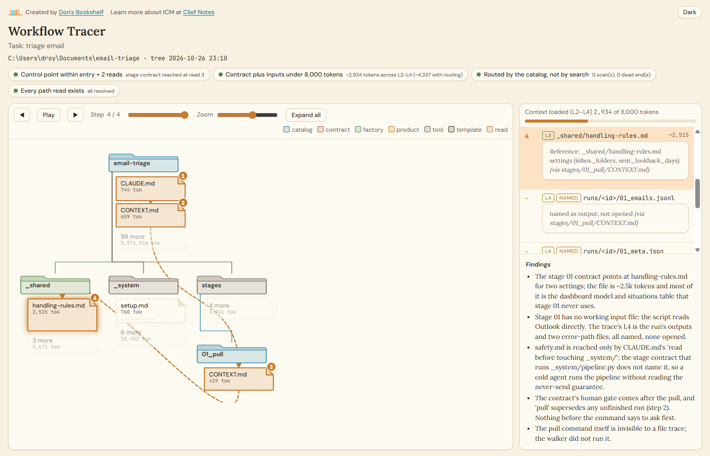
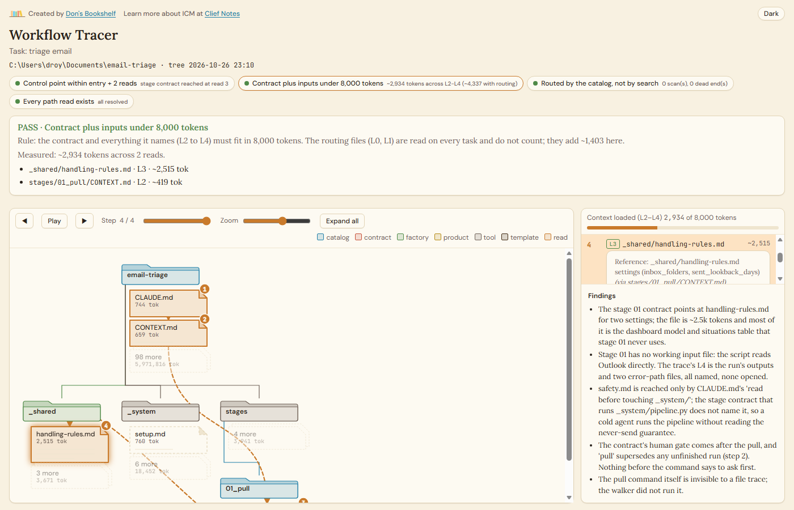
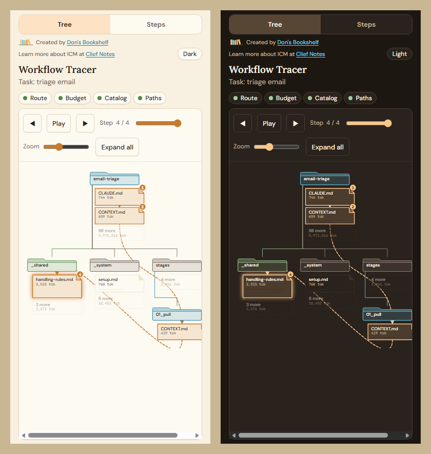

# Workflow Tracer

A Claude Code skill that shows you where your folder structure sends an agent before you trust it with the task.

Give it a task. A cold agent walks your workspace exactly as it would if it were about to start, logging every file it opens and why, and stops at the point where the work would begin. It never does the task. You get one HTML file that draws your folders as a bracket, overlays the route, and grades it against the ICM invariants.



## Why

If you build workspaces where the folders do the orchestration (an [ICM](https://www.skool.com/cliefnotes/about?ref=f4482ac988fb4a7b8da3efa95cfc1d00) workspace, a repo with a `CLAUDE.md` map, a vault with an index), you are making a claim: an agent given a task opens the entry file, follows the routing to one stage, reads that stage's contract and the inputs it names, and stops, all in a few thousand tokens.

Workflow Tracer tests that claim. It answers four questions you cannot answer by reading your own docs, because you already know where everything is:

1. Does the routing reach the file that says what to do within the entry file plus two reads?
2. How much context does that file and everything it names actually load?
3. Did the agent have to search, or did the catalog route it?
4. Does every path the files point at exist?

## Install

Copy the `workflow-tracer` folder into your Claude Code skills folder:

```
~/.claude/skills/workflow-tracer/
```

Requirements: Claude Code, and Python 3.10 or later on the path (the script uses the standard library only). Nothing to `pip install`.

## Use

In Claude Code, from the workspace you want to test:

```
/workflow-tracer triage email
```

Or name the root:

```
/workflow-tracer C:\Users\me\Documents\email-triage triage email
```

The task is whatever you would type to an agent. The trace shows where that sentence sends it.

What happens:

1. The tree is scanned and the dashboard opens in your browser, marked pending.
2. A subagent walks the workspace cold. It starts with the root, the task and the walk rules, nothing else. It logs each file the moment it opens it.
3. The main session checks the walker's log against its report, runs the four checks, rewrites the page, and reports the route, the verdicts, the findings, and the one structural change that would most shorten the route.

The output is a single HTML file. Open it from disk, send it to someone, or keep it next to the workspace it describes. No server, no account.

## Reading the dashboard



**The four checks** sit at the top. Green passes, red fails. Click one to see the rule it applies, what was measured on this trace, and the steps it was judged on.

| Check | Passes when |
|---|---|
| Route | the first file that says what to do for this task (the L2 contract) is reached within the entry file plus two more reads |
| Budget | that contract plus everything it names (L2 to L4) is under 8,000 tokens; the routing files above it are read on every task and do not count |
| Catalog | the walker never had to Glob, Grep, or hit a dead end |
| Paths | every path a file pointed at exists on disk |

**The bracket** draws folders as tabbed folders fanning sideways, and each folder's files as pages stacked under it in a drawer. A page is drawn as tall as it is heavy, so a file that blows the budget looks like the brick it is. Everything off the route folds into one "N more" page per drawer. Read files carry a numbered badge, and the dashed line is the route. Dashed outlines are inputs the contract named that the walker checked but did not open.

**The step list** gives each read its layer, the line that sent the agent there, and the running total against the budget. Play replays the walk; the arrows step it.

**Layers** are assigned by the question the file answered, never by its name:

| Layer | The file is... |
|---|---|
| L0 | the entry file |
| L1 | a file whose only job was to send you to another file |
| L2 | the first file that told you what to do for this task. Exactly one. |
| L3 | a file the L2 says to obey on every task |
| L4 | the material the task would act on |

The dashboard follows your system theme and has a Dark/Light switch. It works on a phone, with a Tree/Steps switch and pinch zoom.



## What it will not do

- **Do the task.** If the task is an edit, the trace ends at the contract that would make it.
- **Fix the workspace mid-trace.** A trace that found a dead end reports it. Moving files during the walk destroys the evidence.
- **Walk in the main session.** The session that invoked the skill has already read half your workspace. Only a cold subagent shows what the structure does to a fresh agent.
- **Run commands.** A script the contract says to run is noted, not run.

## What is in the folder

```
workflow-tracer/
  SKILL.md                    the procedure Claude Code follows
  README.md                   short orientation
  scripts/tracer.py           tree scan, step logging, the four checks, the HTML bundle
  assets/dashboard.html       the page (a fragment; tracer.py wraps it)
  assets/brand/               Don's Bookshelf tokens, logo glyph, favicon
  references/walker-brief.md  the whole prompt the cold walker receives
examples/
  email-triage-trace.html     a finished trace to open and click around
docs/screenshots/
```

`tracer.py` on its own:

```
python -I tracer.py tree ROOT -d DIR            # scan the folder, write a pending page
python -I tracer.py read PATH -d DIR --layer L2 --why "..." --via FROM
python -I tracer.py read PATH -d DIR --layer L4 --named --why "named as input; not opened"
python -I tracer.py scan "PATTERN" -d DIR --why "..."
python -I tracer.py miss "WHAT" -d DIR --why "..."
python -I tracer.py done -d DIR --task "..." --finding "..." # the checks, then the page
python -I tracer.py html -d DIR -o out.html     # rebuild the page anywhere
```

Token counts are bytes divided by four. Close enough to see a budget blow, not a bill.

## Credits

Created by [Don's Bookshelf](https://donsbookshelf.com/). The dashboard uses the Don's Bookshelf design system.

ICM, the Interpretable Context Methodology, is the folder-as-architecture approach this skill tests. Learn more at [Clief Notes](https://www.skool.com/cliefnotes/about?ref=f4482ac988fb4a7b8da3efa95cfc1d00).

MIT licence.
